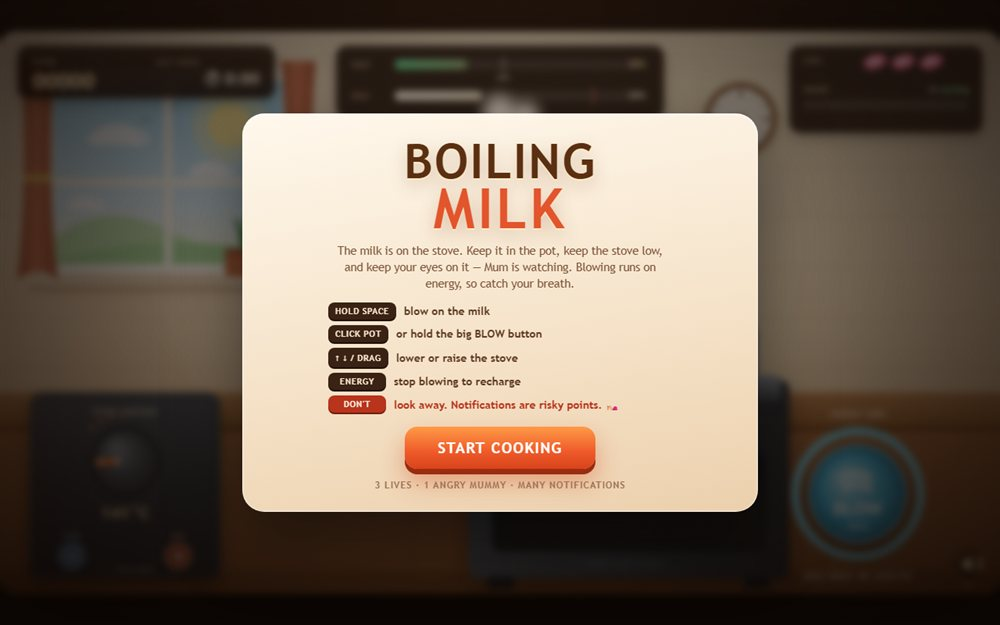

# Boiling Milk - Don't Let It Spill!

A timing game about the most Indian of emergencies: milk on the stove and the three seconds before it boils over.

**[Open the live site](https://ajeet-iitk.github.io/Boiling-Milk1/)**

## What it does

The pot heats up, the foam climbs, and you have to pull it off the flame at the right moment. Leave it a beat too long and the kitchen counters pay for it.

## Features

- Canvas-rendered stove and pot with a live heat simulation
- Timing-based scoring - too early is as bad as too late
- Best run persisted in `localStorage`
- Bubbling audio generated with the Web Audio API

## Run locally

Open `index.html`, or play the hosted build:

<https://ajeet-iitk.github.io/Boiling-Milk1/>

## Files

| File | Purpose |
| --- | --- |
| `index.html` | Landing page |
| `boiling-milk.html` | The game |

---

Part of [my collection of small projects](https://github.com/Ajeet-iitk).
